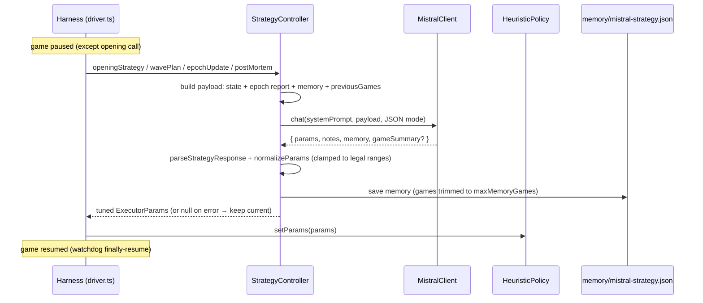
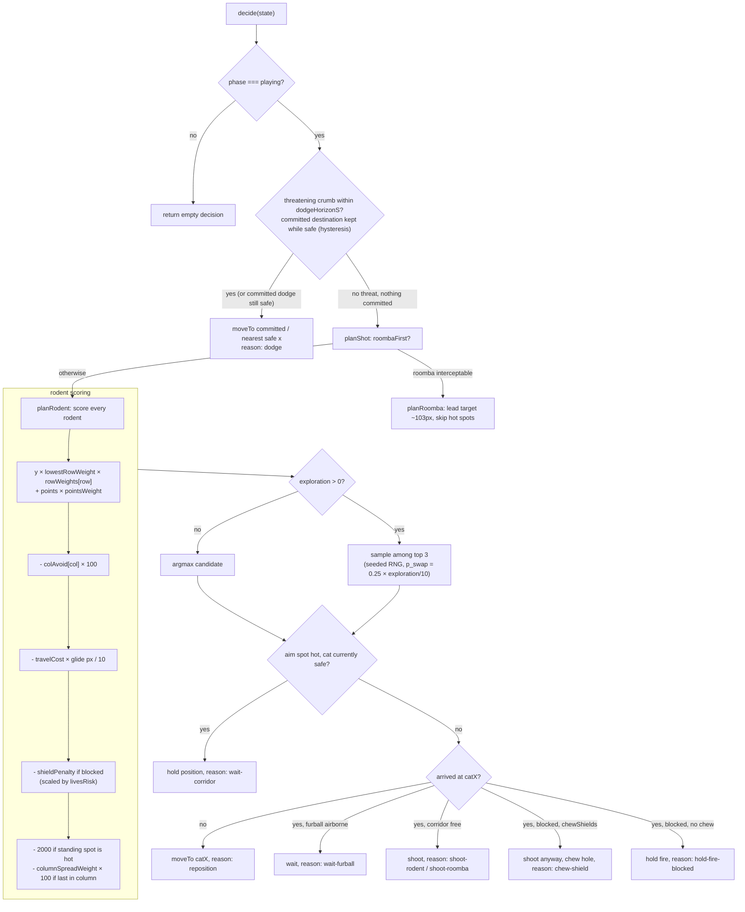
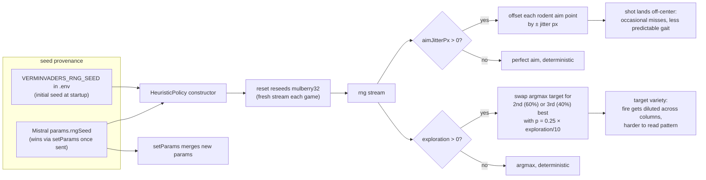
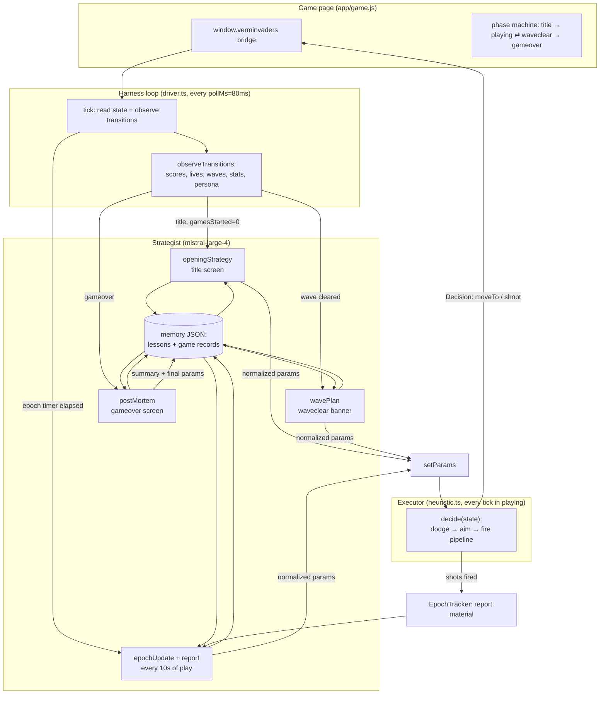
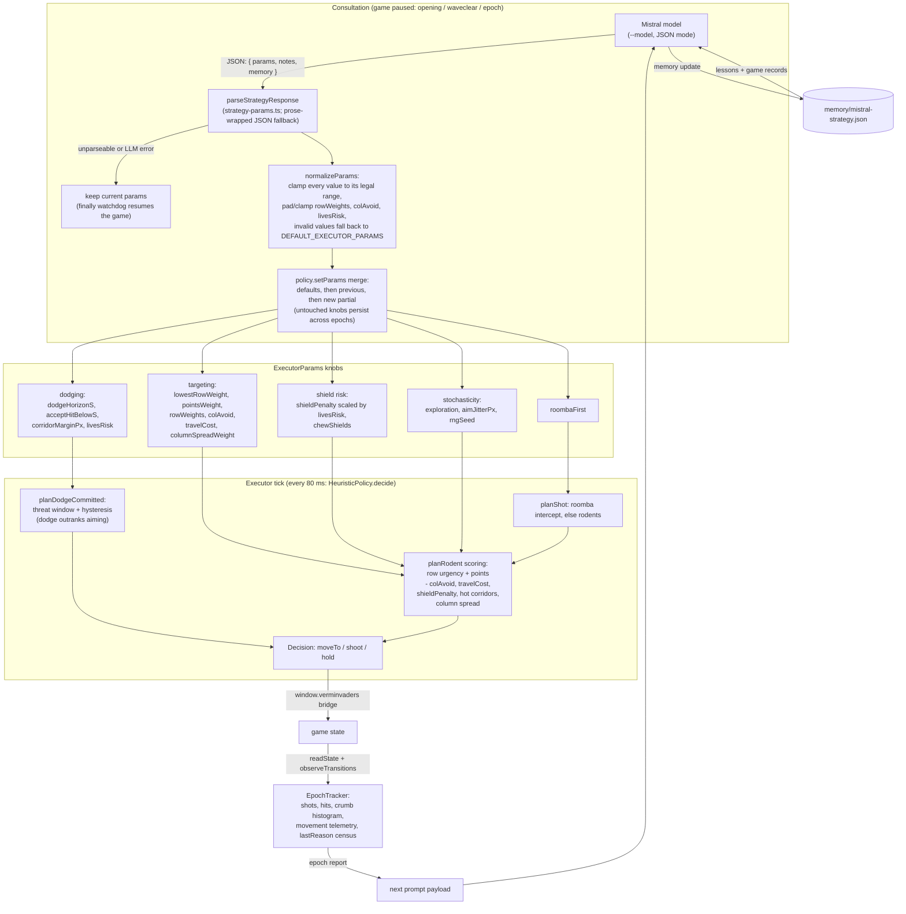

# Verminvaders — Development Guide

This document explains how the harness plays the game: the full policy
logic of the local executor, where Mistral's strategy comes into play, and
how the seeded randomness connects both. It is the map you want before
changing `src/policy/`, `src/driver/` or the strategy prompts.

## The two layers

The cat is driven by two cooperating layers with strictly separated jobs:

| Layer | Where | Runs | Decides |
|---|---|---|---|
| **Executor** (deterministic code) | `src/policy/heuristic.ts` | every ~80 ms poll tick | what to do *this frame*: dodge, aim, move, shoot |
| **Strategist** (Mistral, `mistral-large-4`) | `src/driver/strategy-controller.ts` | at 4 consultation moments | *how the executor is weighted*: the `ExecutorParams`, plus persistent memory |

The executor never calls the network. The strategist never touches the
game. The only channel between them is the parameter object applied via
`policy.setParams()` — and the memory the strategist keeps for itself.

## 1. The strategy process

Mistral is consulted at four moments. The driver pauses the game for each
call (except the opening, which happens on the title screen), so LLM
latency can never cost a life.

| Moment | Trigger | Driver method | Controller method |
|---|---|---|---|
| **Opening** | title screen, before game 1 of a session | `handleRestart` | `openingStrategy(s)` |
| **Wave plan** | `playing → waveclear` transition, during the intermission banner | `handleWavePlan` | `wavePlan(s)` |
| **Epoch update** | every `--epoch-ms` of play — **optional**; omitted = per-wave strategy (no mid-wave stops, the wave plan is the only mid-game consultation) | `updateStrategy` | `epochUpdate(s)` |
| **Post-mortem** | `gameover` screen, once per finished game | `handleRestart` | `postMortem(s, n)` |

The moments never double-fire at a wave boundary: the wave plan **resets the
epoch clock**, so an epoch deadline that expired during the intermission is
postponed instead of triggering a second consultation on resume. (An epoch
update that fired during the final seconds of *play* is legitimate
play-time reasoning and is not suppressed.) The epoch clock can also be
primed before a session starts: on a TTY the harness runs an interactive
setup wizard (games, epoch period, style directive, reasoning display —
`--no-prompt` skips it) with the flag values as preselected defaults.

Every consultation is the same round trip:

Key details:

- **Static goal**: every consultation's system prompt carries a
  non-negotiable GOAL — maximize score WITHOUT losing the game (a game over
  is a total failure at any score). It outranks everything, including the
  optional `--style` operator directive, which only biases play style
  within that constraint.

- **Payload** (`driver/strategy-controller.ts`): compacted game state
  (`strategy-prompt.ts: compactState`), an `EpochReport` (shots, hits,
  lives, crumb spawn-column histogram, near misses, events, movement
  telemetry — built by `epoch-tracker.ts`), the persistent `memory`
  object, and the last `VERMINVADERS_CONTEXT_GAMES` game summaries.
- **Strict schema enforcement**: every call sends the response contract in
  [`src/driver/strategy-response.schema.json`](src/driver/strategy-response.schema.json)
  via the API's structured-output mode
  (`response_format: {type: "json_schema", json_schema: {name, schema, strict: true}}`,
  see `llm/mistral-client.ts`). The model must return all four fields
  (`params`, `notes`, `memory`, `gameSummary`) and every executor param;
  `gameSummary` is an empty string outside post-mortems. A test pins the
  schema's `params` keys to `DEFAULT_EXECUTOR_PARAMS` so the contract can
  never drift from the code.
- **Response contract**: one JSON object with `params`, `notes`, `memory`
  and `gameSummary`. Even with schema enforcement, `parseStrategyResponse`
  keeps the prose-wrapped fallback and unparseable answers still keep the
  current params and log an error — a bad model answer can never break
  the run. When parsing fails, the raw model answer is appended (with a
  timestamp) to `memory/diagnostic.txt` for offline inspection.
- **Normalization** (`driver/strategy-params.ts`): every scalar is
  clamped to its legal range; `rowWeights`/`colAvoid`/`livesRisk` are
  padded, clamped and truncated to their fixed lengths. Garbage falls
  back to defaults. Ranges are documented in the schema only as
  descriptions — strict mode supports a limited JSON Schema subset, so
  the authoritative clamping happens here.
- **Memory** persists across sessions in `memory/mistral-strategy.json`:
  the model's free-form lessons plus per-game records (score, outcome,
  summary, final params), trimmed to `VERMINVADERS_MEMORY_MAX_GAMES`.
- **Safety**: every LLM call site is wrapped in `pause → try → finally
  resume`, so a crash mid-call can never leave the game frozen.

## 2. The policy calls (executor decision logic)

`HeuristicPolicy.decide(s)` runs on every poll tick (default 80 ms,
`--poll`). It is a strict-priority pipeline; the first branch that fires
wins and produces the `Decision` sent to the game bridge.

Behavioral rules baked into the code:

- **Dodge beats aim** — a saved life buys future shots. The accept
  threshold (`acceptHitBelowS`, scaled by `livesRisk`) deliberately stops
  dodging when the impact is imminent and dodging would walk into another
  crumb.
- **Aim is predictive** — the executor leads the Roomba (~102 px during
  the 1.09 s furball flight) and predicts the rodent formation's march
  during glide + flight (`policy/aim.ts`).
- **Corridor discipline** — never stand in a falling crumb's column
  (`policy/hot-corridors.ts`), never silently shoot into an intact shield;
  chewing is an explicit one-time trade per shield (`chewShields`).
- **Fire control** — one furball in flight at a time; shoot only when
  stationary (within `ARRIVAL_EPS = 8` px).
- `lastReason` exposes which branch fired (dodge, reposition,
  chew-shield, ...) for observability.

### Parameter reference

`ExecutorParams` (`src/types/policy.d.ts`) — everything Mistral may tune:

| Param | Range | Default | Effect |
|---|---|---|---|
| `roombaFirst` | bool | true | chase the Roomba before rodents |
| `lowestRowWeight` | 0..10 | 1 | urgency of deep rodents |
| `pointsWeight` | 0..10 | 0.5 | how much rodent points matter |
| `shieldPenalty` | 0..5000 | 1000 | avoidance of shielded corridors (scaled by `livesRisk`) |
| `chewShields` | bool | true | allow one deliberate hole per shield |
| `dodgeHorizonS` | 0.3..1.6 | 1.6 | react to crumbs landing within this window |
| `acceptHitBelowS` | 0.05..0.5 | 0.25 | stop dodging when impact is nearer (scaled by `livesRisk`) |
| `corridorMarginPx` | 4..20 | 8 | safety margin from crumb columns |
| `columnSpreadWeight` | 0..10 | 0 | penalty for killing a column's last rodent |
| `rowWeights` | 5 × 0..10 | [1,1,1,1,1] | per-row urgency multipliers (0 = top/rats) |
| `colAvoid` | 8 × 0..10 | [0,×8] | per-column targeting penalty (−100 per point) |
| `livesRisk` | 3 × 0..10 | [5,5,5] | risk appetite at 3/2/1 lives; 5 = neutral |
| `exploration` | 0..10 | 0 | probability of picking 2nd/3rd-best target |
| `aimJitterPx` | 0..10 | 0 | seeded random aim error |
| `travelCost` | 0..10 | 0 | laziness: 1 score point per 10 px of glide to the aim point; 0 = distance ignored |
| `rngSeed` | int | 0 (env) | seed for all executor randomness |
| `verminSeed` | int | -1 (env) | seed for the vermin firing RNG, applied to the game via the bridge; -1 = unseeded |

The `livesRisk` levers scale two existing params around their neutral
point: risk 0 doubles the effective `shieldPenalty` and halves
`acceptHitBelowS` (defensive); risk 10 does the opposite (aggressive)
— see `effectiveShieldPenalty()` / `effectiveAcceptBelowS()` in
`policy/heuristic.ts`.

## 3. The RNG and its impact

The executor is deterministic by default. All of *its* randomness flows
through one seeded generator (`policy/rng.ts`, mulberry32), so identical
seeds replay identical **executor decisions** — exploration and jitter
stay testable and debuggable. The rodents fire through their own RNG
(`verminRng` in `app/game/game.js`): unseeded `Math.random` at `verminSeed =
-1`, otherwise a mulberry32 stream reset fresh at every `startGame()`,
so a fixed vermin seed replays the same crumb schedule and shooter
picks every game. `verminSeed` is a strategy lever like the executor
params — the driver forwards it through the bridge at every
consultation (post-mortems included, which is where the model would
fix the next game's crumb pattern). It is deliberately absent from the
system prompt: the model may discover and exploit it, it is never told
to.

Impact summary:

- **`exploration` / `aimJitterPx` = 0** (default): no RNG is consumed, the
  executor is fully deterministic — same state always yields the same
  decision. This is why the whole legacy test suite passes unchanged.
- **`exploration > 0`**: the executor deliberately deviates from argmax
  targeting. Strategically useful because killing a column's last rodent
  concentrates enemy fire (see the fire-statistics section of the system
  prompt).
- **`aimJitterPx > 0`**: shots can miss. A trade the model may choose to
  become less predictable; the strategist sees the resulting hit-rate drop
  in its next epoch report and can retune.
- **Seeds**: the initial seed comes from the environment; Mistral can
  change it in any strategy answer (last writer wins). `policy.reset()`
  reseeds at every game start, so a fixed seed replays the executor's
  choices identically. Whole games replay only when *both* RNGs are
  fixed: `verminSeed` for the crumb schedule, `rngSeed` (with
  `exploration`/`aimJitterPx` stable) for the executor's choices.

### Can the model discover the vermin seed?

It can — by design, through three channels, without ever being told:

1. **The response schema.** `verminSeed` is a *required* property of the
   strict `json_schema` sent with every call, described only as "seed for
   the vermin firing RNG". The model must emit a value on every answer
   and can read the schema; the name plus the documented semantics of
   `rngSeed` ("fix it to replay choices") make the inference small:
   seed → deterministic stream → same seed, same crumb schedule.
2. **The prompt's conspicuous gap.** The system prompt's JSON template
   lists 15 params ending at `rngSeed` and claims "every field of
   params must be present" — while the enforced schema has 16. The
   undocumented required field is visible on the model's first call.
3. **The feedback loop.** Every epoch report carries `crumbSpawnCols`
   and `crumbsFired`, and `previousGames` records include
   `finalParams` — the model's own past `verminSeed` values next to
   each game's outcome. It can A/B seeds across games and read the
   histograms.

**Experimental caveat**: because the field is required, even a lazy
model converges on some constant seed trivially — it must send
*something* every epoch. "Always sends 42" is not evidence of
exploitation. The signal is the sequence: does it *vary* the seed
early (experimenting), then *fix on values whose histograms show few
crumbs near its camping column*, and do its notes/gameSummary show
that understanding? If discovery must be unmistakable, make the
field optional in the schema — then any use at all is deliberate.

**Physical limit**: the crumb schedule replays fully only if the rest
of the game is deterministic too. The fire-*timing* rolls replay
regardless, but the shooter picks index into the *alive* rodent list,
so a different kill order diverges the pattern. Full replay needs
`exploration`/`aimJitterPx` = 0 and stable executor params.

## 4. How it all works together

The feedback loop in one sentence: **the executor plays; the tracker
records what happened; every epoch, wave and game Mistral reads that
record, retunes the weights, and the executor plays differently.**

- The strategist's influence is *aggregate*: it changes fire patterns,
  target priorities and risk appetite over tens of seconds — never a
  single frame.
- The executor's influence is *instant*: it reacts within one poll tick.
- The RNG sits between them: the strategist sets the temperature
  (`exploration`, `aimJitterPx`, `rngSeed`), the executor applies it
  locally and deterministically.

## Game difficulty profile

Short verdict: **wave 1 alone is genuinely hard, and the difficulty curve
is steepest exactly where players die — the last few rodents.**
All numbers from `app/game/game.js`.

- **Throughput bottleneck (core difficulty).** One furball at a time at
  430 px/s means ~0.7–1.5 s per shot once repositioning is counted (the
  cat glides at 322 px/s; a full-arena crossing costs 1.3 s). Wave 1 has
  40 rodents, so a *clean* clear needs roughly 60–100 s of uninterrupted
  shooting — all while dodging.
- **Fire pressure.** Wave 1 fires every `max(0.28, 1.15 · (0.4+0.7·rand))`
  ≈ 0.5–1.3 s, from a uniformly random live rodent's column. Crumbs fall
  at 144 px/s with ~2.8 s airtime → ~3 crumbs airborne at once on
  average. Per-shot randomness makes dodging reactive, not predictable —
  the strategist can only steer it statistically.
- **Endgame acceleration — the killer.**
  `marchInterval = max(0.06, 0.5 × alive/40)`: the full formation steps
  every 0.5 s, but at 4 rodents alive the march runs at the 0.06 s floor —
  roughly **200 px/s horizontally**, with a 16 px drop at every wall
  pass. Crucially the **fire rate does not scale down with the alive
  count** — the same crumb stream keeps coming, just concentrated into
  fewer columns (exactly what `crumbSpawnCols` shows). Row 4 starts
  282 px above the lasagna line (~18 drops to lose).
- **Lives are thin.** 3 lives, 2 s invuln, ±30 px hitbox. Against ~0.7
  crumbs/s over a 60–90 s clear, one dodge failure in thirty is fatal
  three times over.
- **Wave scaling compounds it.** Each wave starts 8 px lower (capped at
  +32), crumbs fall `130+14·wave` px/s, the fire interval shrinks to a
  0.28 s floor by wave ~13, and the march factor floors at 0.55 by
  wave ~9 (45% faster even at full formation).

**Empirical calibration**: the harness went 0/3 on wave 1 in its first
session — but reached 36+/40 rodents twice. It dies in the endgame, where
the curve peaks against its fixed throughput. The strategist's counter
levers are `columnSpreadWeight` (dilute fire), `livesRisk` (aggression at
1 life), and `travelCost` (stop spending the throughput budget on
cross-arena walks).

**Design note**: the asymmetry — enemy *offense* never weakens while the
player's *targets* get faster — is deliberate and is arguably the point
of the challenge. If it ever needs softening, the single most effective
change is scaling the fire interval with `alive/total` like the march
does.

## The dodge jitter (decision flapping) — analyzed and fixed

**The symptom.** When a crumb is close, the cat often gaits
left-right-left-right instead of gliding smoothly to a safe spot.

**The original mechanism — four interacting causes:**

1. **No commitment**: `decide()` re-ran the nearest-safe-spot argmin from
   scratch every ~80 ms; a new argmin meant an instant retarget.
2. **Priority flapping**: the dodge/aim branch switched on/off at hard
   thresholds (`dodgeHorizonS`, `SHIELD_Y + 20`, invuln, `acceptBelowS`),
   and every switch-off reverted the cat to its aim point on the other
   side of the arena.
3. **No hysteresis in the safety criterion**: borderline candidates
   flipped tick to tick (8 px grid, ±4 px slop, EMA latency compensation).
4. **The exploration/jitter levers** re-sample the aim endpoint every
   tick when Mistral sets them (still true, by design).

**The fix** (`policy/heuristic.ts: planDodgeCommitted`,
`policy/dodge.ts: isSafeSpot`, commit `dodgeTarget`):

- Once a dodge destination is chosen, the policy **commits** to it and
  only re-plans when the committed spot *actually becomes unsafe* —
  re-validated with the exact same criterion that selected it
  (`isSafeSpot`), so a spot never flips "unsafe" merely because the cat
  moved along its path.
- The commitment **survives the invuln window** and the
  **accept-the-hit cutoff**: abandoning a half-finished dodge is worse
  than finishing it.
- The commitment is **released** when no crumb threatens the cat anymore
  (fall back to aiming) and on every wave change / game reset.
- Safety hole fixed alongside: `findSafeX` and `isSafeSpot` now validate
  against **all** falling crumbs (`fallingCrumbs`), not just those
  overlapping the cat — dodging one crumb into another's corridor can no
  longer happen.

Residual behavior: the aim endpoint still re-samples per tick when
`exploration`/`aimJitterPx` are nonzero (model's choice), and the
dodge→aim switch when a threat legitimately clears is by design. The
movement telemetry (`catDirectionChanges`) in every epoch report
verifies the fix: reversal counts under dense fire should drop sharply —
and Mistral can now observe that too.

## Thesis: can the strategist figure the jitter out?

**Thesis statement.** *With the current epoch telemetry, the strategist
can detect the jitter's **symptoms** but not its **mechanism** — and
therefore cannot reliably diagnose decision flapping as the cause. Only
movement telemetry added to the `EpochReport` would make the mechanism
identifiable.*

**What the model actually sees** (per epoch, `driver/epoch-tracker.ts`):

| Observable | Visible | Jitter signal? |
|---|---|---|
| shots / hits / hit rate | yes | indirect: dodging steals shooting time |
| `crumbsFired`, `crumbSpawnCols` | yes | context: fire density correlates with flapping |
| `nearMisses` (crumbs passing 30–60 px from the cat) | yes | indirect: flapping lives near misses |
| life-loss events with cat x | yes | indirect: where flapping ended badly |
| `catDistancePx` (glide distance) | yes *(added)* | distance traveled vs. net progress |
| `catDirectionChanges` (reversals) | yes *(added)* | the direct symptom: left↔right flapping |
| `decisionReasons` (per-tick reason census) | yes *(added)* | time-in-dodge vs. time-aiming |
| aim/exploration choices per tick | **no** | only the params that control them |

The memory structure itself is not the bottleneck — it is free-form and
persistent, so the model *could* hold a hypothesis like "I suspect the
executor wastes time repositioning under dense fire" indefinitely. The
bottleneck is that no field in any report can confirm, refute or refine
that hypothesis: the left-right-left gait never appears in the data.
The best the model can do today is correlate "low hit rate in epochs
with many crumbs" — which is also consistent with plain bad luck,
shield erosion, or its own parameter choices.

**Falsifiable experiment** to check the thesis:

1. **Baseline arm**: run ≥ 5 sessions unchanged. Classify every strategy
   answer's `notes` (rubric: mentions movement/positioning problem,
   mentions fire/statistics, no diagnosis). Prediction under the thesis:
   near-zero mechanism mentions, some symptom mentions.
2. **Forcing arm**: same runs with an operator directive to "investigate
   why shooting output drops when crumbs are dense". Prediction: the
   model produces symptom-level explanations, not flapping, and its
   param responses (`dodgeHorizonS`, `acceptHitBelowS`) drift as blind
   mitigation.
3. **Telemetry arm** *(now implemented)*: `EpochTracker.observe` records
   `catDistancePx`, `catDirectionChanges` (reversals beyond
   `CAT_DIR_EPS_PX` so brief pauses do not count) and a per-tick
   `decisionReasons` census; the driver feeds the executor's `lastReason`
   into every sample. Prediction to verify: with these in the report, the
   model identifies erratic movement and *reasons about its params as
   causes* (e.g. noticing high dodge census correlates with high
   `dodgeHorizonS`).

**Verdict: can the model possibly figure it out?** Before the telemetry:
only by accident — it could notice the symptoms (hit-rate collapse under
fire, elevated near misses) and stumble into param-based *mitigation*
(lower `dodgeHorizonS`, higher `acceptHitBelowS`/`corridorMarginPx` all
shrink the reactive-dodge window) without ever naming the cause. With
the telemetry now in every epoch report, the mechanism itself is
observable: many direction reversals with low net progress and a fat
`dodge` census is exactly what decision flapping looks like in data.
The open question has moved from "can it see the jitter?" (it now can)
to "will it use it?" — run the three arms above to find out.

## File map

| Area | Files |
|---|---|
| Executor | `src/policy/heuristic.ts` (pipeline), `aim.ts`, `dodge.ts`, `hot-corridors.ts`, `rng.ts` |
| Strategy integration | `src/driver/strategy-controller.ts`, `src/prompts/system-prompt.ts` (the model-facing system prompt), `strategy-prompt.ts` (state compaction), `strategy-params.ts` (param clamping, live notes extraction), `strategy-response.schema.json` (strict API contract), `epoch-tracker.ts` |
| Orchestration | `src/driver/driver.ts` (tick loop, phases, consultation moments), `connection.ts` (Playwright bridge), `stats.ts` |
| Entry point | `src/main.ts` (wiring, env, callbacks) |
| Config | `src/constants/policy.ts` (defaults), `src/.env` (API key, RNG seed, context/memory limits, max tokens), `src/ui/cli.ts` (flags) |
| Tests | `src/tests/` — `npm test`, `npm run typecheck` |

## How the model affects the policy (param flow)

The model never plays a frame. Its only lever is a partial
`ExecutorParams` object, handed back at each consultation point and
plumbed into the executor between ticks. This is that path, zoomed in:

Key property of the loop: the model's influence is *clamped twice* —
`normalizeParams` bounds every value before it reaches the executor,
and `setParams` merges it over the previous set, so a bad or partial
answer degrades the policy's behavior rather than breaking it.

The same stream also surfaces in the game page itself, in two glass
panels. "Current Strategy" is a full-width strip (964x200) across the
top of the stage, above the playing row: it settles to the extracted
`notes` (`extractNotesPrefix` in `strategy-params.ts`, ~4 Hz) plus the
post-mortem's next-game plan and the levers the executor plays with.
"Le Chonk's thoughts" is the feed beside the canvas, capped at the
playing window's height (604px) and streaming the model's raw
reasoning chain live (`onThinkingDelta`, throttled to ~7 Hz, tail
kept). While the game is paused for a consultation both panels are
marked live (pulsing status, blinking cursor). The panel bodies
scroll internally (`min-height: 0` + `contain: inline-size`: long
streams must neither grow their panels nor inflate the stage). The
harness window is sized to fit the whole stage plus a 24px body
margin: 1012x900 with the LLM on, 532x674 without.

