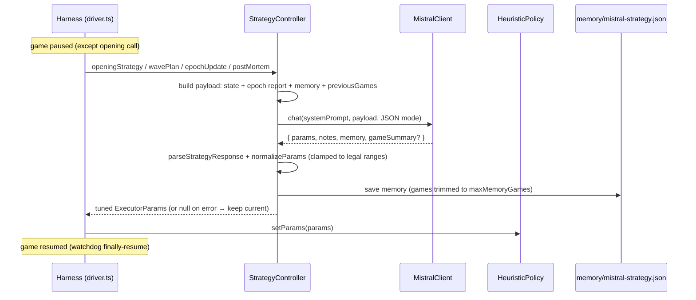
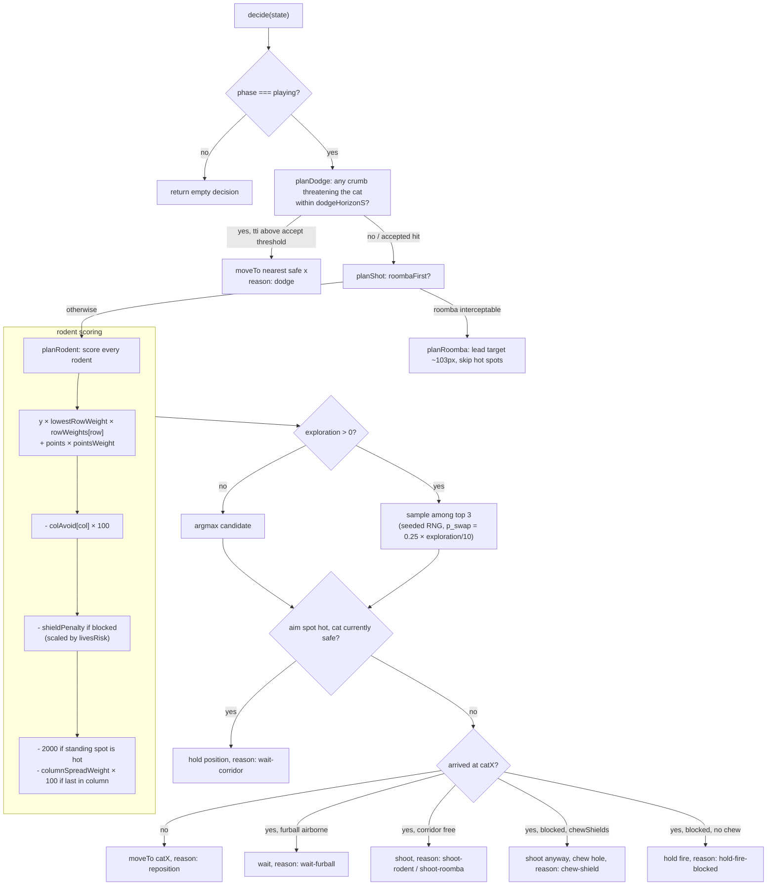
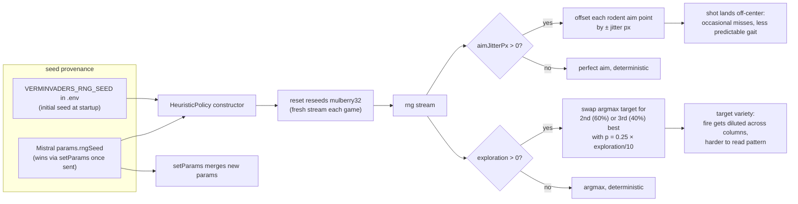
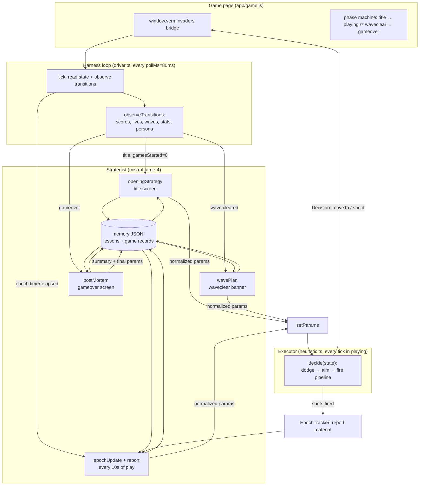

# Verminvaders — Development Guide

This document explains how the harness plays the game: the full policy
logic of the local executor, where Mistral's strategy comes into play, and
how the seeded randomness connects both. It is the map you want before
changing `src/policy/`, `src/driver/` or the strategy prompts.

## The two layers

The cat is driven by two cooperating layers with strictly separated jobs:

| Layer | Where | Runs | Decides |
|---|---|---|---|
| **Executor** (deterministic code) | `src/policy/heuristic.ts` | every ~80 ms poll tick | what to do *this frame*: dodge, aim, move, shoot |
| **Strategist** (Mistral, `mistral-large-4`) | `src/driver/strategy-controller.ts` | at 4 consultation moments | *how the executor is weighted*: the `ExecutorParams`, plus persistent memory |

The executor never calls the network. The strategist never touches the
game. The only channel between them is the parameter object applied via
`policy.setParams()` — and the memory the strategist keeps for itself.

## 1. The strategy process

Mistral is consulted at four moments. The driver pauses the game for each
call (except the opening, which happens on the title screen), so LLM
latency can never cost a life.

| Moment | Trigger | Driver method | Controller method |
|---|---|---|---|
| **Opening** | title screen, before game 1 of a session | `handleRestart` | `openingStrategy(s)` |
| **Wave plan** | `playing → waveclear` transition, during the intermission banner | `handleWavePlan` | `wavePlan(s)` |
| **Epoch update** | every `--epoch-ms` (default 10 s) of play | `updateStrategy` | `epochUpdate(s)` |
| **Post-mortem** | `gameover` screen, once per finished game | `handleRestart` | `postMortem(s, n)` |

Every consultation is the same round trip:

Key details:

- **Payload** (`driver/strategy-controller.ts`): compacted game state
  (`strategy-prompt.ts: compactState`), an `EpochReport` (shots, hits,
  lives, crumb spawn-column histogram, near misses, events — built by
  `epoch-tracker.ts`), the persistent `memory` object, and the last
  `VERMINVADERS_CONTEXT_GAMES` game summaries.
- **Strict schema enforcement**: every call sends the response contract in
  [`src/driver/strategy-response.schema.json`](src/driver/strategy-response.schema.json)
  via the API's structured-output mode
  (`response_format: {type: "json_schema", json_schema: {name, schema, strict: true}}`,
  see `llm/mistral-client.ts`). The model must return all four fields
  (`params`, `notes`, `memory`, `gameSummary`) and every executor param;
  `gameSummary` is an empty string outside post-mortems. A test pins the
  schema's `params` keys to `DEFAULT_EXECUTOR_PARAMS` so the contract can
  never drift from the code.
- **Response contract**: one JSON object with `params`, `notes`, `memory`
  and `gameSummary`. Even with schema enforcement, `parseStrategyResponse`
  keeps the prose-wrapped fallback and unparseable answers still keep the
  current params and log an error — a bad model answer can never break
  the run.
- **Normalization** (`driver/strategy-params.ts`): every scalar is
  clamped to its legal range; `rowWeights`/`colAvoid`/`livesRisk` are
  padded, clamped and truncated to their fixed lengths. Garbage falls
  back to defaults. Ranges are documented in the schema only as
  descriptions — strict mode supports a limited JSON Schema subset, so
  the authoritative clamping happens here.
- **Memory** persists across sessions in `memory/mistral-strategy.json`:
  the model's free-form lessons plus per-game records (score, outcome,
  summary, final params), trimmed to `VERMINVADERS_MEMORY_MAX_GAMES`.
- **Safety**: every LLM call site is wrapped in `pause → try → finally
  resume`, so a crash mid-call can never leave the game frozen.

## 2. The policy calls (executor decision logic)

`HeuristicPolicy.decide(s)` runs on every poll tick (default 80 ms,
`--poll`). It is a strict-priority pipeline; the first branch that fires
wins and produces the `Decision` sent to the game bridge.

Behavioral rules baked into the code:

- **Dodge beats aim** — a saved life buys future shots. The accept
  threshold (`acceptHitBelowS`, scaled by `livesRisk`) deliberately stops
  dodging when the impact is imminent and dodging would walk into another
  crumb.
- **Aim is predictive** — the executor leads the Roomba (~102 px during
  the 1.09 s furball flight) and predicts the rodent formation's march
  during glide + flight (`policy/aim.ts`).
- **Corridor discipline** — never stand in a falling crumb's column
  (`policy/hot-corridors.ts`), never silently shoot into an intact shield;
  chewing is an explicit one-time trade per shield (`chewShields`).
- **Fire control** — one furball in flight at a time; shoot only when
  stationary (within `ARRIVAL_EPS = 8` px).
- `lastReason` exposes which branch fired (dodge, reposition,
  chew-shield, ...) for observability.

### Parameter reference

`ExecutorParams` (`src/types/policy.d.ts`) — everything Mistral may tune:

| Param | Range | Default | Effect |
|---|---|---|---|
| `roombaFirst` | bool | true | chase the Roomba before rodents |
| `lowestRowWeight` | 0..10 | 1 | urgency of deep rodents |
| `pointsWeight` | 0..10 | 0.5 | how much rodent points matter |
| `shieldPenalty` | 0..5000 | 1000 | avoidance of shielded corridors (scaled by `livesRisk`) |
| `chewShields` | bool | true | allow one deliberate hole per shield |
| `dodgeHorizonS` | 0.3..1.6 | 1.6 | react to crumbs landing within this window |
| `acceptHitBelowS` | 0.05..0.5 | 0.25 | stop dodging when impact is nearer (scaled by `livesRisk`) |
| `corridorMarginPx` | 4..20 | 8 | safety margin from crumb columns |
| `columnSpreadWeight` | 0..10 | 0 | penalty for killing a column's last rodent |
| `rowWeights` | 5 × 0..10 | [1,1,1,1,1] | per-row urgency multipliers (0 = top/rats) |
| `colAvoid` | 8 × 0..10 | [0,×8] | per-column targeting penalty (−100 per point) |
| `livesRisk` | 3 × 0..10 | [5,5,5] | risk appetite at 3/2/1 lives; 5 = neutral |
| `exploration` | 0..10 | 0 | probability of picking 2nd/3rd-best target |
| `aimJitterPx` | 0..10 | 0 | seeded random aim error |
| `rngSeed` | int | 0 (env) | seed for all executor randomness |

The `livesRisk` levers scale two existing params around their neutral
point: risk 0 doubles the effective `shieldPenalty` and halves
`acceptHitBelowS` (defensive); risk 10 does the opposite (aggressive)
— see `effectiveShieldPenalty()` / `effectiveAcceptBelowS()` in
`policy/heuristic.ts`.

## 3. The RNG and its impact

The executor is deterministic by default. All randomness flows through one
seeded generator (`policy/rng.ts`, mulberry32), so identical seeds replay
identical games — exploration and jitter stay testable and debuggable.

Impact summary:

- **`exploration` / `aimJitterPx` = 0** (default): no RNG is consumed, the
  executor is fully deterministic — same state always yields the same
  decision. This is why the whole legacy test suite passes unchanged.
- **`exploration > 0`**: the executor deliberately deviates from argmax
  targeting. Strategically useful because killing a column's last rodent
  concentrates enemy fire (see the fire-statistics section of the system
  prompt).
- **`aimJitterPx > 0`**: shots can miss. A trade the model may choose to
  become less predictable; the strategist sees the resulting hit-rate drop
  in its next epoch report and can retune.
- **Seeds**: the initial seed comes from the environment; Mistral can
  change it in any strategy answer (last writer wins). `policy.reset()`
  reseeds at every game start, so game N replays identically for a fixed
  seed.

## 4. How it all works together

The feedback loop in one sentence: **the executor plays; the tracker
records what happened; every epoch, wave and game Mistral reads that
record, retunes the weights, and the executor plays differently.**

- The strategist's influence is *aggregate*: it changes fire patterns,
  target priorities and risk appetite over tens of seconds — never a
  single frame.
- The executor's influence is *instant*: it reacts within one poll tick.
- The RNG sits between them: the strategist sets the temperature
  (`exploration`, `aimJitterPx`, `rngSeed`), the executor applies it
  locally and deterministically.

## Known behavior: decision flapping near thresholds

The executor re-decides from scratch every tick with no commitment, and
dodge safety is evaluated at the cat's arrival time — so when crumbs are
dense, the chosen safe spot can flip sides tick to tick and the cat
gaits left-right-left. This is **accepted current behavior** (see
`planDodge`/`findSafeX` in `policy/dodge.ts`), not a bug: it emerges from
the nearest-safe-candidate search plus threshold crossings
(`dodgeHorizonS`, `SHIELD_Y + 20`, invuln windows). If it ever needs
fixing, the approaches are: commit to a dodge destination while it stays
safe (hysteresis), evaluate `findSafeX` with a fixed arrival horizon, and
re-sample exploration targets per shot instead of per tick.

## File map

| Area | Files |
|---|---|
| Executor | `src/policy/heuristic.ts` (pipeline), `aim.ts`, `dodge.ts`, `hot-corridors.ts`, `rng.ts` |
| Strategy integration | `src/driver/strategy-controller.ts`, `strategy-prompt.ts`, `strategy-params.ts`, `strategy-response.schema.json` (strict API contract), `epoch-tracker.ts` |
| Orchestration | `src/driver/driver.ts` (tick loop, phases, consultation moments), `connection.ts` (Playwright bridge), `stats.ts` |
| Entry point | `src/main.ts` (wiring, env, callbacks) |
| Config | `src/constants/policy.ts` (defaults), `src/.env` (seed, limits, API key), `src/ui/cli.ts` (flags) |
| Tests | `src/tests/` — `npm test`, `npm run typecheck` |
